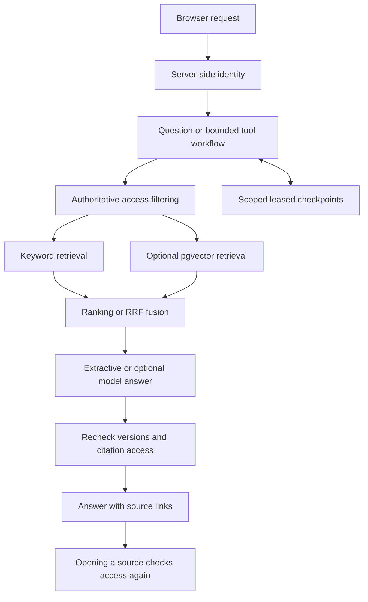

# Enterprise RAG Agent

An AI-assisted learning project for **authorized retrieval, tool workflows and repeatable evaluation**.

企业知识问答实验：先检查资料权限，再检索、生成回答与展示引用；使用合成数据观察工作流恢复、混合检索和评测结果。

[Quick start](#quick-start) · [Architecture](#architecture) · [Runtime modes](#runtime-modes) · [Walkthrough](docs/DEMO.md) · [Design & limits](docs/DESIGN.md) · [CI](https://github.com/zongemory-spec/enterprise-rag-agent/actions/workflows/tests.yml)

## What this project demonstrates

| Area | Implemented behavior |
| :--- | :--- |
| Access boundaries | Tenant / group / owner filtering before retrieval; citation access checked again when opened. |
| Retrieval | Keyword and lexical hash-vector baselines; optional PostgreSQL / pgvector and RRF hybrid retrieval. |
| Workflows | Bounded tool execution, durable checkpoints, leases and version / permission revalidation on resume. |
| Model adapters | Optional real-model planning, answer synthesis and semantic embeddings; billable calls are opt-in. |
| Evaluation | Fixed synthetic questions, retrieval / refusal / citation metrics, and downloadable CI reports. |
| Observability | Local run metadata and optional request-level Langfuse tracing. |

Current source version: **v3.4**. The dataset contains **24 synthetic documents**. This is a learning project, not a production enterprise deployment.

## Quick start

Use **Python 3.12** from the repository root. Start with the offline SQLite route; it needs no model key or external database.

```sh
python -m venv .venv
```

Activate the environment for your shell:

| Shell | Command |
| :--- | :--- |
| Windows PowerShell | `.\.venv\Scripts\Activate.ps1` |
| macOS / Linux | `source .venv/bin/activate` |

```sh
python -m pip install -r requirements.lock
python run_server.py --port 8006
```

Open **http://127.0.0.1:8006**. Initialization creates synthetic data and a private `data/demo_auth.json`. Copy the token for `alice` in tenant `demo` into the page's **访问凭证** field; keep this file local.

Select **关键词基线**, ask a question, then click a citation to inspect its source. Follow the [step-by-step demo](docs/DEMO.md) to compare users and try the workflow / ticket route.

The app does not automatically load a root `.env` file. Use the supported environment variables or private configuration described in the mode guides. Do not put credentials in source files.

## Architecture



The server determines identity and permissions. Questions, retrieved text and model output do not grant access. Checkpoints preserve progress; they are not an authority for document access. See [the design and data dictionary](docs/DESIGN.md) for storage, revocation and tracing boundaries.

## Runtime modes

| Mode | Requirements | What to expect |
| :--- | :--- | :--- |
| **Offline default** | Python + SQLite | Keyword / hash-vector retrieval, extractive answers and scripted single-step routing. No paid API calls. |
| **Real planning / synthesis** | Provider configuration; `--real` | Native model tool planning and model answers. Paid requests may occur; semantic retrieval is not enabled automatically. |
| **PostgreSQL / pgvector** | Your PostgreSQL configuration and a built index | Database-backed storage and vector / hybrid routes. A hash-vector index alone is not semantic embedding. |
| **Semantic retrieval** | PostgreSQL, embedding configuration, request budget and explicit index build; `--semantic` | Real embedding queries and optional RRF fusion. Indexing and queries may be billable. |
| **Tracing** | Explicit Langfuse configuration | Request-level traces; not a full distributed tracing or production monitoring claim. |

Read the [semantic guide](docs/真实Embedding升级与测试.md), [real-agent guide](docs/真实Agent升级与启动.md), and [hybrid guide](docs/混合检索升级与测试.md) before opting in. Some historical helper scripts contain original machine paths; adapt private configuration to your machine rather than running those helpers unchanged.

## Checks and evaluation

```sh
python -m unittest discover -s tests -v
python evaluate.py --split dev --out reports/local-dev.json
```

Choose a fresh `--out` path: the evaluator refuses to overwrite an existing report. It writes **JSON details and a same-name Markdown summary**.

The [GitHub workflow](.github/workflows/tests.yml) runs tests with a pgvector service, then evaluates the **offline keyword and hash-vector dev baselines**. In the workflow run, open **Artifacts → offline-dev-evaluation-…** to download `ci-dev.json` and `ci-dev.md`; the Markdown also appears in the job summary when generated. Artifacts are retained for 14 days.

The evaluation artifact records the dataset hash, method, metrics and per-question results. It is **not** a real-model, semantic-embedding or pgvector quality benchmark, even though the preceding test job uses PostgreSQL. See [how to read the report](docs/DEMO.md#read-the-evaluation-report).

Historical files under `reports/` are dated evidence, not fresh CI results. Check the actual workflow conclusion and its source commit before citing a result.

## Limits

- Lexical retrieval is not BM25; no reranker is claimed.
- A small synthetic dataset does not establish production accuracy, enterprise scale or general security.
- Exact-quote support checks do not establish semantic relevance or answer completeness.
- Local demo credentials are not production SSO; checkpoints and databases need host-level protection.
- Real-model checks can cost money and are not part of the default offline evaluation.

Detailed boundaries: [design](docs/DESIGN.md), [2026-10-01 engineering notes](docs/UPGRADE_20261001.md), [2026-10-02 verification notes](docs/UPGRADE_20261002.md).

## Code map

| Path | Responsibility |
| :--- | :--- |
| `rag_app/api.py`, `security.py` | HTTP entry points, identity and access checks |
| `retrieval.py`, `hybrid.py`, `pg_native_index.py` | Ranking, RRF fusion and the native vector index |
| `workflow.py`, `checkpoint.py` | Tool workflow and durable recovery |
| `planner.py`, `generation.py`, `synthesis.py`, `embedding.py` | Optional model adapters |
| `data/synthetic/`, `data/questions.json` | Fictional documents and evaluation questions |
| `tests/`, `evaluate.py` | Regression checks and fixed-set evaluation |

Paths in the first four rows are inside `rag_app/`.

## Development and provenance

This project was developed with AI assistance. [Source history](docs/SOURCE_HISTORY.md) explains the imported snapshots and original records; commits are not backdated. The `snapshot/v1` through `snapshot/v3.4` tags and `archive/*` branches preserve earlier work. See [historical notes](README.legacy.md) and [contribution guidance](CONTRIBUTING.md).

Use synthetic examples in issues and pull requests. Do not upload tokens, provider keys, private documents or generated databases.
