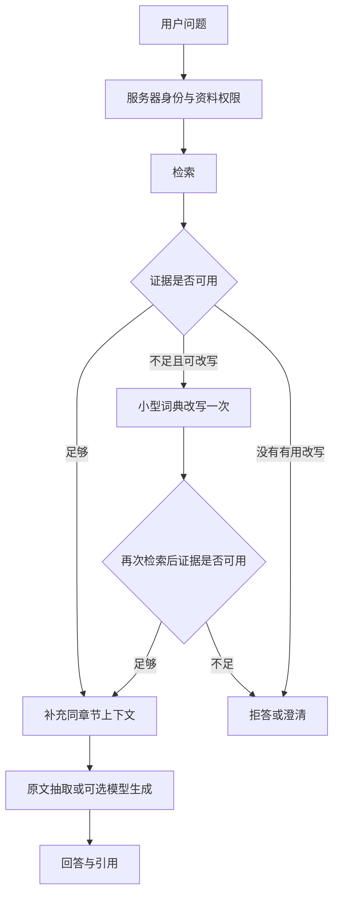

# RAG 与 Agent 个人展示项目 · v4.2

一个用于学习与展示 **AI、大模型、RAG、Agent、LangChain 和 LangGraph** 的小型项目。默认使用本机 SQLite、合成资料和原文抽取即可运行；也提供真实模型和平台接入的可选路径。

通过具体案例体现企业场景中的权限、引用、版本与评测意识。项目的主要目标是让设计可理解、流程可演示、结果可复现。

## 先运行，再看设计

使用 Python 3.12，在解压后的目录运行：

```powershell
python -m venv .venv
.\.venv\Scripts\python.exe -m pip install -r requirements.lock
.\.venv\Scripts\python.exe run_server.py --port 8006
```

macOS / Linux 将 Python 路径换成 `.venv/bin/python`。打开 http://127.0.0.1:8006 ，从本机生成的 `data/demo_auth.json` 取租户 demo 下 alice 的 token，填入页面并点击“载入我的会话和资料”。

默认无须模型 Key、Docker、PostgreSQL 或云平台账号。凭证、数据库、虚拟环境与模型权重均不包含在源码 ZIP 中。

**展示入口：[六分钟演示路线](docs/SHOWCASE.md)**。也可以执行一条离线演示命令：

```sh
python demo_walkthrough.py --out reports/my-showcase.json
```

脚本使用临时合成数据库，运行纠错、章节上下文、澄清和清理案例，不修改你的日常资料，也不调用外部模型。

## 这个项目能说明什么

|概念|实际实现|
|---|---|
|大模型|可选的真实模型 API；默认回答抽取原文，默认 Agent 使用脚本路由|
|RAG|文档 → 分块 → 检索 → 证据检查 → 回答与引用|
|Agent|在限定工具中选择知识搜索或工单查询；启用真实规划时由模型选择|
|LangChain|真实使用 Document、BaseRetriever、StructuredTool、可选 ChatOpenAI|
|LangGraph|规划与工具流程，以及“检索不足 → 改写 → 最多重试一次”的条件图|
|BM25 / 向量 / 混合|BM25、哈希词项向量对照、可选 pgvector、RRF 融合、可选神经重排|
|评测与观测|Recall@1、Hit@1、Recall@4、MRR@4、拒答及引用指标；可选 Langfuse|
|企业场景意识|检索前权限过滤、引用复查、资料更新、恢复校验和用户数据范围|



图示的“再次检查”会依据结果选择回答或拒答。权限或服务异常直接返回错误，不以重试绕过。

## v4.2 的四个展示重点

### 1. 纠错检索与澄清

- 输入“报账”：首次不足时，使用明确的小型词典改写为“报销”，最多再检索一次。
- 词典在 `rag_app/query_rewrite.py`，当前包含报账、入司、休假等少量别名；这是可解释的查询处理，不需要训练模型。
- 没有有用改写时不重复发送同一请求。页面可展开查看实际检索过程。
- 先问“差旅报销和入职材料分别有什么要求？”，再问“那具体呢？”：系统请你选择主题，不猜测指代。
- 所有候选和澄清选项都来自当前仍可访问的资料。

### 2. 章节分块与上下文

上传 `data/showcase/section-policy.md` 观察章节与原始行号。Markdown 标题、Word Heading 样式会形成章节；无标题文本仍按行切分，PDF 保留页码。

先检索小片段，再补充同文档、同版本、同章节内已授权的相邻片段。扩展只在数量/字符预算允许时增加内容，不跨章节拼接。原始检索排名与实际上下文分开记录，引用始终指向可打开的片段。

已有数据库中的文档不会自动重分块；使用新解压目录，或以新版本重新上传资料即可演示新分块方式。它没有通用版面识别或 OCR 功能。

### 3. 评测回归门禁

```sh
python -m unittest discover -s tests -v
python evaluate.py --split dev --out reports/my-dev.json
python check_evaluation.py --report reports/my-dev.json --out reports/my-gate.json
```

`evaluation_gate.json` 定义数据集/题数、指标阈值和相对 v4.1 的允许变化。指标缺失、NaN、权限泄漏计数非零或指标超出阈值时，门禁以非零状态退出。CI 默认运行离线测试、评测和门禁；PostgreSQL 集成测试可在手动运行工作流时选择。

固定集包含 24 篇合成文档、60 道问题，dev/test 各 30 道。默认只评测 dev，最终 test 仍需 `--allow-test`。本次结果见 `reports/v4.2-dev.md`、`v4.2-gate.json`。纠错和澄清等案例单独记录在 `v4.2-showcase.json`，不混入固定集准确率。

多文档题首位命中一篇时，Recall@1 可能是 0.5，而 Hit@1 为 1。逐字引用检查只验证摘录存在；这些指标不能替代人工理解和语义评分。

### 4. 数据导出、保留与清理

页面“数据管理”支持导出自己的可访问记录、按天数预览清理、确认执行。可选清理自己拥有的非活跃资料旧版本，默认保留最新 2 个版本。

- 保留近期仍有对话活动的会话，避免仅依据创建时间误删。
- 按用户与租户隔离；保留活跃资料、访问凭证、未结束任务、活跃工作流租约、预算和审计元数据。
- “清理全部个人记录”可清理已结束的工作流状态；检查点缺少创建时间，因此按天清理不猜测其年龄。
- 清理为逻辑删除数据库记录。停止运行中的请求后操作；旧备份、已下载文件和兼容外部 PGIndex 的旧副本不在该清理范围。

命令行默认只预览，显式 `--apply` 才删除。先在本机环境中设置有效的 `RAG_EVAL_TOKEN`：

```sh
python cleanup_data.py --env-file .env --days 30
python cleanup_data.py --env-file .env --days 30 --apply
```

可选 `--all-personal-records`、`--prune-document-versions --keep-versions 2`。不要把真实 token 写进源码。

## 保留的 v4.1 能力

- PDF、DOCX、Markdown、TXT 上传，默认个人可见；去重、乐观版本更新、撤销和原生 pgvector 增量索引。
- 多轮 RAG、引用打开、反馈标注、已确认反馈集再评测。
- Dify 完整问答/外部知识 API、Coze 完整问答/纯检索 API，平台身份与用户身份分开校验。
- 可选真实 Embedding、CrossEncoder/HTTP 重排、模型证据检查、Langfuse 分步观测。
- 应用层租约检查点、只读工具范围与调用预算。

更多端点和操作说明：[v4.1 验证记录](reports/v4.1-validation.md)、[Dify 接入](integrations/dify/WORKFLOW.md)、[Coze 接入](integrations/coze/WORKFLOW.md)。

## 可选配置

复制 `.env.example` 为 `.env` 并填写需要的项目，然后显式加载：

```sh
python run_server.py --env-file .env --port 8006
```

|配置|效果|
|---|---|
|`RAG_CORRECTIVE=on`|启用有界别名纠错，默认开启|
|`RAG_SECTION_CONTEXT=on`|补充同章节上下文，默认开启|
|`RAG_MODEL_URL/KEY/NAME` + `--real`|LangChain 模型规划与证据综合，可产生 API 费用|
|`RAG_EVIDENCE_MODE=model` + 持久预算配置|模型证据充分性及 Agent 综合答案支持度检查|
|`RAG_RERANKER=cross-encoder`|本地神经重排；另装 requirements-ml.txt 并准备模型权重|
|`RAG_RERANKER=http`|调用兼容 /rerank 协议的服务，需重排 Key 和预算|
|`RAG_TRACING=langfuse`|配置三项 LANGFUSE_* 后发送阶段元数据|
|`RAG_PLATFORM_AUTH_FILE`|启用本机私有的 Dify/Coze 平台凭证映射|

`--real` 不会自动打开付费 Embedding。启用真实向量检索时，在环境中设置 PostgreSQL、Embedding 的端点/Key/模型/维度及预算，先构建再运行：

```sh
python sync_pg.py --env-file .env --real
python run_server.py --env-file .env --semantic --port 8006
```

本机已有 Docker 时可用 `compose.pg.yaml` 准备演示数据库。真实服务可用性探测：

```sh
python verify_services.py --env-file .env --allow-external --strict --out reports/my-services.json
```

缺少配置记录为 not_configured；HTTP 协议测试通过与真实模型效果、平台账号联调分别记录。本轮没有新增外部服务验证要求。

## 主要代码与阅读顺序

1. `rag_app/service.py`：RAG 主流程与检索/上下文分离。
2. `rag_app/langchain_components.py`：框架组件适配和服务器身份绑定。
3. `rag_app/workflow.py`、`corrective.py`：Agent 图与有限纠错图。
4. `rag_app/sections.py`、`evidence_policy.py`：章节上下文及证据判断。
5. `rag_app/conversation.py`、`retention.py`：指代澄清和用户记录管理。
6. `evaluate.py`、`check_evaluation.py`：指标、基线和回归门禁。

项目由 AI 协助开发；上游版本和本次定位见 `SOURCE_BASELINE.json`，原始来源说明在 `docs/SOURCE_HISTORY.md`。历史 reports 按版本保留。当前代码使用应用层检查点桥接；LangGraph 原生 Saver、复杂 OCR、多 Agent 协作和分布式部署没有纳入本次范围。

重新打包源码：

```sh
python package_source.py --out dist/enterprise-rag-agent-v4.2-source.zip
```
