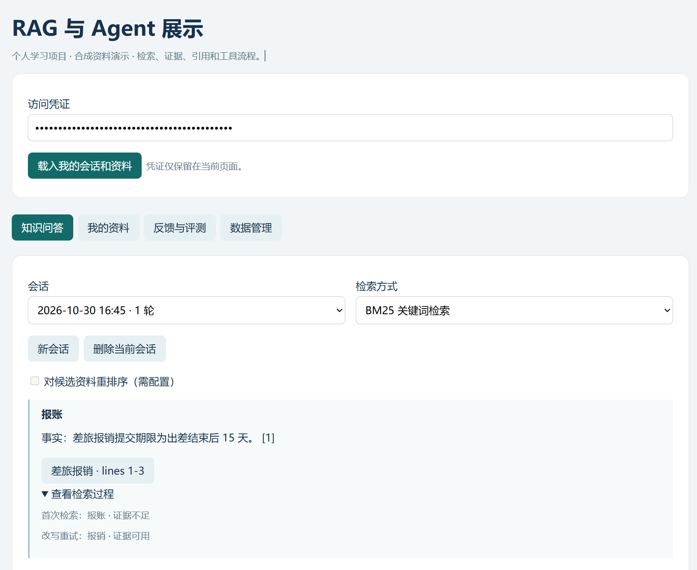
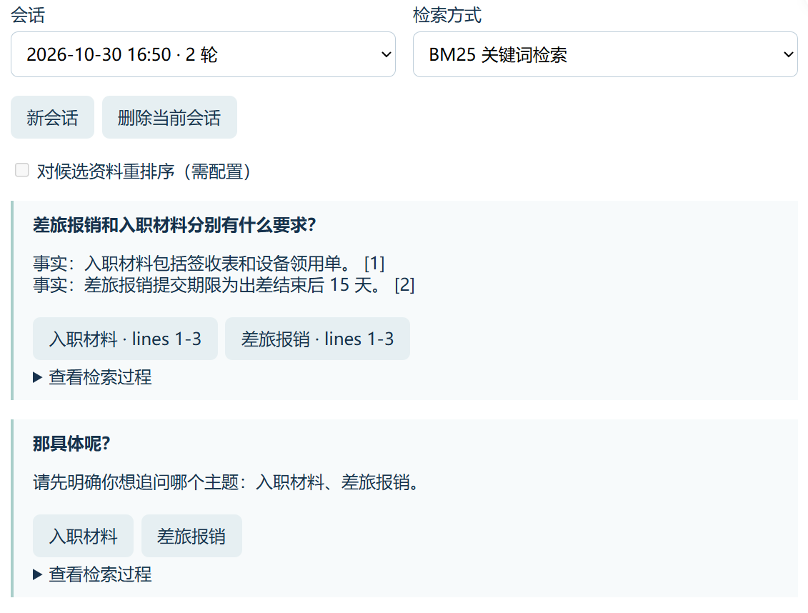
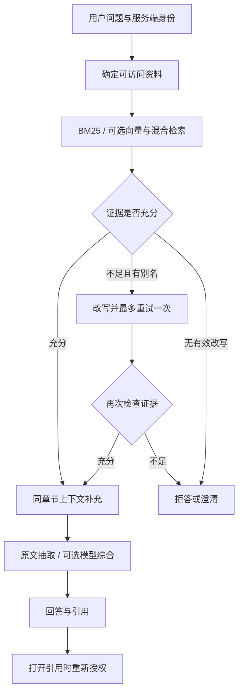

<div align="center">

# Enterprise RAG Agent

**让回答有出处，让检索有边界。**

RAG 与 Agent 个人学习项目 · v4.2  
以合成资料演示权限检索、查询改写、多轮澄清与可复现评测。

[六分钟演示](docs/SHOWCASE.md) · [设计说明](docs/DESIGN.md) · [评测报告](reports/v4.2-dev.md) · [反馈问题](https://github.com/zongemory-spec/enterprise-rag-agent/issues)

[](https://github.com/zongemory-spec/enterprise-rag-agent/actions/workflows/tests.yml)
[](LICENSE)

</div>

---

## 项目背景与目标

知识问答不只需要找到相似文本：用户的说法可能与资料不同，追问可能指代多个主题，回答引用也可能因资料撤销而失效。加入 Agent 工具后，还需要限制工具调用和恢复任务时的权限。

本项目围绕这些问题搭建一个可在本机运行、可观察处理过程、可重复验证的原型：**先确定访问范围，再检索证据；证据不足时有限纠错或澄清，回答后仍可核查来源。**

默认使用 SQLite、合成资料和原文抽取，无需模型 key。真实模型、语义 Embedding、重排与平台接入均为可选配置，不将离线演示当作真实模型效果。

## 演示：从用户问题到可核查证据

### 用词不一致时，有限改写后再检索

输入“报账”，首次检索证据不足；小型别名词典将其改写为“报销”，最多再检索一次，返回附有来源的结果。页面展示两次检索状态。



这是词典驱动的查询处理，不是模型自主纠错；没有有效改写时不会重复请求，权限与服务异常也不会通过重试绕过。

### 多主题追问先澄清，回答保留引用入口

先问“差旅报销和入职材料分别有什么要求？”，再追问“那具体呢？”，系统返回主题选项，请用户明确指代。引用入口展示资料标题和行号，打开时重新校验访问权限。



以上展示具体案例，不据此推断整体准确率。完整操作路线见 [SHOWCASE](docs/SHOWCASE.md)。

## 关键实现与设计取舍

| 问题 | 实现 | 取舍 |
| --- | --- | --- |
| 用户用词与资料不一致 | BM25 检索、小型别名词典和一次纠错分支 | 有界、可解释；不覆盖任意语义改写 |
| 片段缺少上下文 | 按章节切分，补充同文档、同版本、同章节的已授权邻接片段 | 控制字符与数量预算，不跨章节拼接 |
| 多轮追问不明确 | 单主题补充来源标题，多主题返回可选项 | 不猜测模糊指代，复杂对话仍需扩展评测 |
| 检索与引用可能越权 | 服务端身份、检索前授权、打开引用及恢复时复查 | 本地演示凭证不是生产 SSO |
| Agent 调用范围失控 | 限定工具、调用预算、应用层租约检查点 | 默认脚本路由，真实模型规划需显式启用 |
| 升级后效果回退 | 固定题集、逐题报告、阈值与基线门禁 | 小型合成集用于回归，不能代替真实业务评测 |

### 技术结构



- **LangChain**：Document、BaseRetriever、StructuredTool 和可选模型适配。
- **LangGraph**：有条件的工具工作流与有限纠错图。
- **存储与检索**：默认 SQLite、BM25 和词项哈希向量；可选 PostgreSQL / pgvector、真实 Embedding 与 RRF。
- **可选集成**：Dify、Coze、CrossEncoder / HTTP 重排、Langfuse；需分别配置和验证。

## 本地运行

使用 Python 3.12，在仓库根目录执行：

```powershell
python -m venv .venv
.\.venv\Scripts\python.exe -m pip install -r requirements.lock
.\.venv\Scripts\python.exe run_server.py --port 8006
```

macOS / Linux 将 Python 路径替换为 `.venv/bin/python`。打开 http://127.0.0.1:8006 ，在本机生成的 `data/demo_auth.json` 中找到 tenant `demo`、用户 `alice` 的 token，填入“访问凭证”，点击“载入我的会话和资料”。

凭证只用于本地演示，不提交到仓库或放进截图。需要配置时复制 `.env.example`，通过 `--env-file .env` 显式加载。默认无需 Docker、外部数据库或付费 API。

离线案例脚本使用临时合成数据库，不修改日常资料：

```sh
python demo_walkthrough.py --out reports/my-showcase.json
```

## 验证结果与评测边界

自动检查包含离线测试、评测和回归门禁；PostgreSQL 集成验证为手动可选任务。具体通过状态以对应提交的 [Actions](https://github.com/zongemory-spec/enterprise-rag-agent/actions) 为准。

以下数值来自仓库附带的 **v4.2 dev 报告**，不是线上用户数据或本次重新运行结果。固定集为 24 篇合成文档、60 道问题，dev/test 各 30 道；表中使用 dev 集。

| 方法 | Recall@1 | Hit@1 | Recall@4 | MRR@4 | 正常题误拒答率 |
| --- | ---: | ---: | ---: | ---: | ---: |
| BM25 | 0.875 | 1.000 | 1.000 | 1.000 | 0.050 |
| 离线混合检索 | 0.850 | 0.950 | 1.000 | 0.975 | 0.050 |

离线混合使用 BM25 与词项哈希向量，不代表语义 Embedding 效果。当前报告中它并未全面优于 BM25，不能因组件更多就宣称效果更好。两种方法均保留待分析题 Q059。详见 [逐项报告](reports/v4.2-dev.md) 与 [门禁结果](reports/v4.2-gate.json)。

```sh
python -m unittest discover -s tests -v
python evaluate.py --split dev --out reports/my-dev.json
python check_evaluation.py --report reports/my-dev.json --out reports/my-gate.json
```

使用未存在的输出文件名。最终 test 集需显式 `--allow-test`，避免与日常 dev 调优混用。多文档题的 Recall@1 与 Hit@1 定义不同；逐字引用检查也不等于语义正确性评估。

## 代码阅读入口

| 路径 | 关注点 |
| --- | --- |
| `rag_app/service.py`、`bm25.py` | 检索流程与候选排名 |
| `rag_app/corrective.py`、`query_rewrite.py` | 有限改写与工作流分支 |
| `rag_app/sections.py`、`evidence_policy.py` | 章节上下文与证据检查 |
| `rag_app/conversation.py`、`retention.py` | 追问澄清、记录导出与清理 |
| `rag_app/langchain_components.py`、`workflow.py` | 框架适配、工具与流程 |
| `evaluate.py`、`check_evaluation.py` | 可复现指标与回归门禁 |

## 已知限制与后续方向

- 这是个人学习原型，没有生产企业部署或大规模准确率结论。
- 默认答案来自原文抽取，默认 Agent 为脚本路由；真实规划、生成和语义检索需要额外配置，可能产生费用。
- 别名纠错与指代处理覆盖有限，尚不具备通用查询理解能力。
- 未包含 OCR、复杂版面识别、多 Agent 协作、分布式部署或 LangGraph 原生 Saver。
- 本地凭证、数据库与备份依赖主机保护；记录清理不涵盖外部副本和已下载文件。
- 后续优先扩展别名与歧义案例、分析 Q059、增加独立语义相关性标注；不将固定集回归结果外推真实业务。

项目由 AI 协助开发，代码与可复现结果用于说明实现，不代表每行代码均独立手写。[来源记录](docs/SOURCE_HISTORY.md)、`SOURCE_BASELINE.json` 与历史报告保留版本背景。

代码采用 [MIT License](LICENSE)。反馈请使用合成资料，移除凭证、私人文档及真实密钥。
