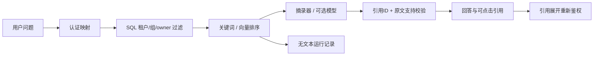

# 设计、数据字典与已知限制

## 边界
服务器控制身份、部门与租户。问题、文档文本、工具参数和模型输出均不可信；本地 ingest 的元数据由受信任管理员提供，不开放 HTTP 上传/改 ACL。返回给模型的块已经过 SQL 权限过滤。引用与历史记录继续检查当前权限，没有共享答案缓存。

## 数据字典
|实体|字段和语义|
|---|---|
|document|document_id 全局唯一；version 单调增加；title；source 合成来源；hash 为正文 SHA-256；tenant_id；owner；allowed_groups；active；created_at|
|chunk|chunk_id 包含文档/版本/片段位置及正文 hash；document_id/version 外键关系；location 行号或页码；text|
|actor|user_id/tenant_id/groups 来自服务器凭证映射|
|原生向量索引|chunk_id/model_id/generation/embedding；其余元数据通过关联权威文档与分块表读取|
|workflow_checkpoints|tenant/actor/workflow 联合主键，state/lease/expires；保存工具进度与结果，私密运行数据|
|run|run_id、tenant/actor、授权块 ID、索引和模型版本、延迟、usage、cost；不保存问题与回答原文|
|question|question_id/query/actor/expected_doc_ids/reference_points/expected_refusal/category/split/forbidden_doc_ids/concept_group|
|audit|request_id/status/固定原因/时间；不记录凭证、问题、模型原始输出或 URL 查询参数|

解析支持 UTF-8 文本、Markdown 和可提取文字 PDF，返回行号/页码；不做扫描件 OCR。500 字符分块；长行切片可能共享行号，chunk_id 区分位置。离线摘录器针对合成语料中的“事实：”段，任意外部正文若没有该标记会拒答；可选模型适配器可以选择原文摘录，但语义相关性仍需评测。

## 版本与同步
内容/标题/ACL/owner 改变必须增加 version，旧版 inactive；相同完整元数据和正文可去重。删除/撤权后立即改变全局索引代次，没有内容缓存。原生 pgvector 使用同一 PostgreSQL 库中的版本和授权集合，返回前再次鉴权；旧代次索引无结果，需显式同步。已完成统一存储；增量向量同步仍未实现。旧 pg_index.py 仅作为历史兼容路径保留。

## 指标
- Recall@4：每道可回答题的相关文档命中比例，再宏平均；多文档题不是命中一篇即成功。
- quote_support_rate：引用摘录逐字出现在授权块中的比例，仅是结构支持检查。
- reference_point_coverage：标注要点出现在摘录回答中的比例；不等价于人工答案质量。
- 正确拒答和正常题误拒答分开；不能用全拒答取得好看的安全指标。
- 泄露：检索、模型上下文、最终结构化引用分开计数。有限样本零事件不能推出线上零风险。
- 延迟：本机顺序请求，无答案缓存，记录 p50/p95/样本数；不是压力测试。
- 离线成本 0 仅指无外部 API；真实适配器未配置价格日期和单价时 cost=null，usage 缺失也为 null。不会把未知成本写 0。
- 没有模型自评分；人工语义复核尚未执行。
- v2 修复了不同身份相同问句跨 split 的问题。仍有相近主题、同知识库与简短合成文档，结果偏容易。不得作为企业生产效果宣传。

## 威胁与未完成的生产能力
提示注入无法添加新工具、改变服务端身份或跨部门检索。真实模型可能选择不相关但逐字存在的摘录，服务端不能仅凭 substring 检测回答质量。runs 表不保存原文；检查点会保存工具调用和结果，恢复时重新验证权限和版本，资料改变则拒绝恢复。数据库访问者仍可读取检查点，需要操作系统和数据库访问控制。
凭证文件是本机演示机制；不具备生产 SSO、TLS、流量限制、备份加密、审计保留策略与管理员门户。仅绑定本机。服务和 SQLite 文件若被篡改，不在模型攻击威胁模型内。
只读 Agent 默认规则规划，外部规划每轮限时 15 秒、最多三次调用，每个检索还可能触发生成请求（20 秒）及 embedding；这不是全链路的硬总时限，网络读取超时也不等于整个系统的延迟 SLA。
已实测 PostgreSQL/pgvector 和真实 Qwen/embedding 小样本。2026-10-02 补齐 Docker 实际构建运行、真实 Langfuse 4 写入查询及 PG 检查点跨容器重启恢复。人工评审及生产能力仍未验收，不能宣称 R0–R6 全部完成。详细证据见 UPGRADE_20261001.md、UPGRADE_20261002.md 与交付报告。

参考：pgvector https://github.com/pgvector/pgvector ，psycopg 参数绑定 https://www.psycopg.org/psycopg3/docs/basic/params.html ，pypdf https://pypdf.readthedocs.io/en/stable/user/extract-text.html 。

